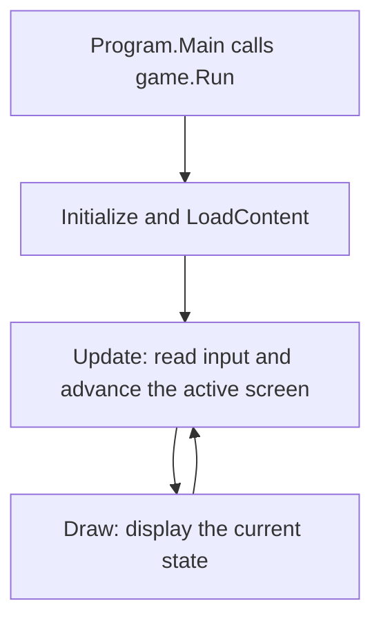

# Learn the game code

Start with the desktop game. It runs the same gameplay code as the browser version and lets you study it without setting up a website or server.

From the project folder, run:

```powershell
dotnet run --project BillusBucket
```

Open `BillusBucket.sln` in your C# editor. Use **Go to Definition** on a method or class name to follow a call into its file.

## Read these files in order

| Step | File | What to learn |
| --- | --- | --- |
| 1 | [Program.cs](../BillusBucket/Program.cs) | Where the desktop app starts and how it creates the game. |
| 2 | [BillusBucketGame.cs](../BillusBucket/BillusBucketGame.cs) | The game loop: read input and update the active screen. |
| 3 | [Game/Playing.cs](../BillusBucket/Game/Playing.cs) | Start a run and follow the five steps of an active gameplay frame. |
| 4 | [Gameplay/BillusBucketRun.cs](../BillusBucket/Gameplay/BillusBucketRun.cs) | Add cash, preserve the best score, and end a run after a bomb. |
| 5 | [Gameplay/BucketControl.cs](../BillusBucket/Gameplay/BucketControl.cs) | Turn input into speed, sliding, braking, and position. |
| 6 | [Gameplay/Drop.cs](../BillusBucket/Gameplay/Drop.cs) and [NoteCatalog.cs](../BillusBucket/Gameplay/NoteCatalog.cs) | Represent one falling object and look up a note's value. |
| 7 | [Gameplay/DropDirector.cs](../BillusBucket/Gameplay/DropDirector.cs) | Choose spawns, fall speeds, delays, and difficulty. |
| 8 | [Gameplay/DropMotion.cs](../BillusBucket/Gameplay/DropMotion.cs) | Move each note independently and drop bombs straight down. |
| 9 | [Gameplay/DropCollision.cs](../BillusBucket/Gameplay/DropCollision.cs) | Catch objects crossing the moving bucket between frames. |
| 10 | [Gameplay/BilluAnimator.cs](../BillusBucket/Gameplay/BilluAnimator.cs) and [BucketFeedback.cs](../BillusBucket/Gameplay/BucketFeedback.cs) | Choose character poses and animate caught notes. |
| 11 | [Presentation/WorldDrawing.cs](../BillusBucket/Presentation/WorldDrawing.cs) | Draw the sky, scene, character, bucket, and falling objects. |
| 12 | [Presentation/InterfaceDrawing.cs](../BillusBucket/Presentation/InterfaceDrawing.cs) | Draw scores, buttons, and the ready/pause/game-over menus. |

The first five steps are enough to understand the main loop, scoring, and movement. The wind and collision calculations can wait until those feel familiar.

## How the folders fit together

```text
BillusBucket/
  Program.cs                 Starts the desktop app
  BillusBucketGame.cs         Chooses what to update each frame
  Game/
    Playing.cs               Connects the gameplay steps
    Input.cs                 Reads controls and converts screen coordinates
    Content.cs               Loads and disposes graphics and audio
  Gameplay/                  Movement, spawns, catches, score, and animation
  Presentation/              Drawing, pixel font, and visual effects
  Audio/                     Music and sound playback
  Assets/                    PNG art, WAV audio, and editable art sources
  Leaderboards/              Score services and leaderboard screens
  Persistence/               Saved local scores
  Platform/                  Desktop/browser support
  Diagnostics/               Art review and capture tools
```

`BillusBucket.Web/`, `backend/`, and the deployment tools support the website and online scores. You can leave them until you want to study those features.

The browser downloads the graphics before starting play and loads sound files in the background. `IAssetStreamProvider.IsAvailable` tells `GameAudio` when a sound has arrived, so it can start using it without reloading the game. See [startup loading](startup-loading.md) for the browser details.

## Why several files say `partial class BillusBucketGame`

`partial` means **one class written across several files**. C# combines those pieces when it builds the game. There is still one `BillusBucketGame` object.

For example, `bucketControl` is declared in `Game/Playing.cs`. The `DrawScene` method in `Presentation/WorldDrawing.cs` can read it because both files belong to that same class. `private` still means it is private to the class.

This keeps the game loop, drawing, input, and leaderboard screens in separate places without adding an extra framework to learn. The smaller classes in `Gameplay/`, such as `BucketControl`, are separate objects with their own jobs.

## The game loop

`Program.Main` creates the game and calls `game.Run()`. MonoGame handles the repeating loop for you:



`Initialize` sets up the window. `LoadContent` loads textures, sounds, and the starting state. Their code is in `Game/Content.cs`.

MonoGame repeatedly calls `Update` to advance the game and `Draw` to display it. These calls do not necessarily happen at exactly the same rate on every device. When the game closes, `UnloadContent` releases resources such as textures and audio.

### Time and position

The game uses a **320 by 180** canvas. `(0, 0)` is the top-left corner. Increasing X moves right; increasing Y moves down. The canvas is scaled to fit the screen, so gameplay positions do not depend on the phone's resolution.

`deltaSeconds` is the time since the previous update. Multiplying speed by time gives distance:

```csharp
// An example: 100 pixels/second for 0.02 seconds moves 2 pixels.
float distance = 100f * 0.02f;
```

The bucket also accelerates and brakes, so its movement code averages its old and new speeds when calculating distance. This produces the sliding feel.

`runSeconds` tracks time played in the current run. Difficulty and the day/night cycle use it. `sceneSeconds` tracks background animation time. Both stop advancing while paused, but only `runSeconds` resets when a new run starts.

## Follow one gameplay frame

Find `UpdateRun` in `Game/Playing.cs`. Its comments mark five steps:

1. **Read movement.** Left contributes `-1`, right contributes `+1`. Pressing both gives zero. A mouse or touch drag can provide a target X position.
2. **Move and animate.** `bucketControl.Update` changes speed and position. `billuAnimator.Update` chooses the pose. `bucketFeedback.Update` advances the note landing animation.
3. **Spawn objects.** Subtract elapsed time from `spawnCountdown`. When it reaches zero, `SpawnDrop` creates an object and adds the next delay.
4. **Move drops and find catches.** Each drop updates its position. The collision code checks the path from its old position to its new position, including the bucket's motion.
5. **Resolve contacts.** Sort catches by their contact time. Notes caught before a bomb count toward the final score; an exact tie gives the bomb priority. Stop processing after the bomb ends the run.

This order matters. Checking only a drop's final position could let a fast note pass through the rim between frames.

### Follow one caught note

`HandleCashCaught` calls `currentRun.CatchCash(drop.Value)`. That method increases the cash total and updates the best score when needed.

The catch also updates the visible pile, plays the collection sound, and creates a floating `+RS` popup. These effects respond to the score event. The pile shows up to five recent notes; it is not the full cash total.

`Drop.NoteIndex` selects the denomination and its sprite design. For example, index `0` identifies Rs 10 and index `4` identifies Rs 500. `NoteCatalog` holds the values and weighted spawn chances.

### Follow one bomb

`HandleBombHit` saves the earned score before `currentRun.HitBomb()` clears the current cash. It switches the round to `GameOver`, starts the burned pose and explosion, clears falling objects, and submits the completed score through the existing service.

The game-over HUD displays `lastRunCash`, so the player can still see the amount earned before the blast.

## Read the movement without getting lost in the maths

`BucketControl` has two important values: `X` is the center position, and `VelocityX` is sideways speed. Acceleration increases speed gradually. Braking reduces it. A stronger turning acceleration lets the player reverse direction. `Math.Clamp` keeps the position inside the rooftop limits.

`DropDirector` decides a spawn once. `DropMotion` then moves that object. Each note has its own seed, breeze timing, and sideways momentum. It eases toward a desired sideways speed and turns gently near the edges. Bombs use their starting X and fall speed to travel straight down.

The bit operations in `DropMotion.WindVelocity` make repeatable random choices from the note's seed. You can first treat that method as “choose the next breeze speed.” The surrounding code shows how that speed affects movement.

`DropCollision` finds the part of the frame where the object overlaps the rim on both X and Y. `time = 0` means the frame's start and `time = 1` means its end. This lets `UpdateRun` handle two contacts in the right order.

## C# syntax you will see

| Syntax | Meaning here |
| --- | --- |
| `class` | Defines an object with stored values and methods. |
| `new BucketControl(...)` | Creates one movement object. |
| `using BillusBucketGame game = ...` | Dispose the game and its resources when this scope ends. |
| `private` | Only this class can use the member directly. |
| `public` | Other classes can use this member. |
| `X { get; private set; }` | Other code can read X; only this class can assign it. |
| `readonly` field | Cannot be reassigned after construction. The object it refers to may still change. |
| `const` | A named value fixed when the code is compiled. |
| `float` and `0.05f` | A decimal number type and a literal of that type. |
| `float? pointerX` | Either a decimal value or `null`, meaning there is no pointer target. |
| `audio?.Play(...)` | Call `Play` only when `audio` exists. |
| `a ?? b` | Use `a` when it exists; otherwise use `b`. |
| `condition ? a : b` | A short choice: use `a` if true, otherwise `b`. |
| `List<Drop>` | A collection of falling objects that can grow and shrink. |
| `enum RoundPhase` | A named choice such as `Ready`, `Playing`, `Paused`, or `GameOver`. |
| `record struct PaperPlacement(...)` | A small group of values describing one visible note's placement. |
| `BigInteger` | A whole number that can grow beyond ordinary integer limits; used for cash totals. |
| `=>` | A short return expression, or a small function passed to another method. |
| `out float hitTime` | Let a method return an additional value through a variable. |
| `ref enter` | Let a method update the caller's existing variable. |
| `%` | Remainder; used to repeat clocks and animation frames. |
| `#if BLAZORGL` | Compile that section for the browser target. |

## Where to look when you have a question

| Question | Start here |
| --- | --- |
| Why does Billu slide after release? | `BucketControl.Step` and its braking calculation. |
| Why did a note move sideways? | `DropMotion.Update` and `WindVelocity`. |
| Why did a bomb appear here? | `DropDirector.Next`. |
| Where are denomination chances? | `NoteCatalog.Values` and `Weights`. |
| What happens when I catch something? | `Playing.cs`: `HandleCashCaught` and `HandleBombHit`. |
| How does pause work? | `BillusBucketGame.Update` and `RoundFlow.TogglePause`. |
| How are walk poses chosen? | `BilluAnimator.Update`, `Frame`, and `SpriteFrame`. |
| Why does the bucket show only a few notes? | `BucketFeedback.Collect` and `WorldDrawing.DrawCatchingBucket`. |
| How does a touch become a game position? | `Game/Input.cs`: `ScreenToCanvasFloatX`. |
| Where are day and night timings? | `SkyMotion.NightAmount`; colors and lighting are in `WorldDrawing.cs`. |
| Where is the pixel font? | `Presentation/PixelFont.cs`. |
| Where is the game-over chai panel? | `InterfaceDrawing.DrawGameOverScreen`; `RoundFlow.SupportButton` holds its button bounds. |

For a first debugging session, place a breakpoint in `HandleCashCaught` and catch one note. Inspect `drop.Value`, then step into `CatchCash` to watch `Cash` and `BestCash` change.

The chai button uses the existing burned character sprite. Desktop opens the support URL through the operating system. In the browser, the platform bridge places a transparent native link over the drawn button, matching the scaled canvas coordinates. This keeps opening a new tab inside the player's click or tap, including on mobile.

## Check your understanding

Before editing the game, try explaining why the drop loop runs backwards, why the pointer target can be null, and why `lastRunCash` is separate from `currentRun.Cash`. Each answer is visible in the gameplay files above.

To run the existing checks:

```powershell
dotnet build BillusBucket.sln -c Release -warnaserror
dotnet run --project GameTests -c Release --no-build
```

Those checks cover movement, scoring, collisions, note motion, animation, the sky cycle, and difficulty, as well as the existing platform and leaderboard support.
